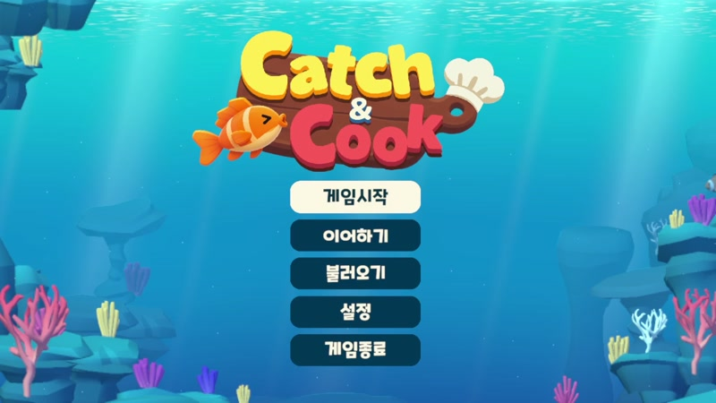

# 팀프로젝트 · DaveTheDiver

Unity 기반 잠수 탐험 게임의 개인 담당 파트 기술 문서입니다. 선상에서 장비를 준비하고, 수중에서 탐색과 전투를 진행한 뒤, 귀환해 획득물을 정산합니다.

## 플레이 시연 영상

튜토리얼, 두 번의 잠수, 초밥집 영업을 차례로 담았습니다. 9분 48초부터 돌연변이 전기 뱀장어 보스전이 시작됩니다.

[전체 영상 내려받기 · 12분 57초 · 한글 자막 (MP4)](https://github.com/lmglmg01/TeamProject/raw/refs/heads/main/media/catch-and-cook-gameplay.mp4)

## 1. 담당 범위

| 번호 | 담당 영역 | 구현 및 연동 범위 |
| --- | --- | --- |
| 1 | [GameManager 기반 씬 전환과 공용 상태 연동](#21-gamemanager-기반-씬-전환과-공용-상태-연동) | 기존 싱글톤에 선상·다이브·야간 씬 전환과 저장 복원 연결 |
| 2 | [플레이어 캐릭터 조작과 다이브 HUD](#22-플레이어-캐릭터-조작과-다이브-hud) | 수중 이동, 무기 전환과 조준, 잠수 상태 표시 |
| 3 | [피격 판정과 DamageableSensor 개선](#23-피격-판정과-damageablesensor-개선) | 기존 피해 인터페이스를 활용한 보스 콜라이더별 피격 필터 |
| 4 | [상점 거래와 공용 인벤토리](#24-상점-거래와-공용-인벤토리) | 구매·판매 검증, 거래 실패 시 골드·수량 복구 |
| 5 | [레벨별 퀘스트와 진행 이벤트](#25-레벨별-퀘스트와-진행-이벤트) | 레벨 1~10 데이터, 선행 조건과 목표 이벤트 연동 |
| 6 | [IInteractable 기반 상호작용](#26-iinteractable-기반-상호작용) | 공통 인터페이스, 거리 기반 대상 선택, NPC 메뉴와 수중 오브젝트 연동 |
| 7 | [전기 뱀장어 보스전](#27-전기-뱀장어-보스전) | 돌진 물기·흡입·꼬리 휩쓸기와 전투 씬 구성 |
| 8 | [JSON 5슬롯 저장·불러오기](#28-json-5슬롯-저장불러오기) | 시작 메뉴 연동, 파일 백업과 이전 저장 호환 |
| 9 | [정상·강제 귀환 정산](#29-정상강제-귀환-정산) | 귀환 유형별 획득 규칙 및 인벤토리·퀘스트 반영 |
| 10 | [Unity 에디터 아이콘 제작 도구 개선](#210-unity-에디터-아이콘-제작-도구-개선) | 캡처 조명·광택·실루엣 옵션과 투명 PNG 경계 처리 |

## 2. 담당 시스템

### 2.1 GameManager 기반 씬 전환과 공용 상태 연동

| 구분 | 내용 |
| --- | --- |
| 문제 | 선상·다이브·야간 씬을 오가면 씬 오브젝트는 교체되지만 인벤토리와 진행 데이터는 이어져야 합니다. |
| 해결 | 기존 `GameManager` 싱글톤을 활용해 씬별 진행을 연결했습니다. 저장 로드 시 `GameSaveService`의 복원 경로를 호출하고, 오후 보트와 야간 씬 이름 변경에 맞춰 이동 목적지를 수정했습니다. |
| 결과 | 잠수 여부와 귀환 결과에 따라 다음 시간대 씬으로 진입하며, 슬롯을 불러오면 공용 진행 상태를 복원합니다. |

~~~mermaid
flowchart LR
    A[선상] --> B{다음 행동}
    B -->|잠수| C[다이브]
    C -->|귀환 정산| D[다음 시간대 씬]
    B -->|시간 보내기| D
    D --> E[GameManager가 새 PlayScene 연결]
    F[저장 슬롯 불러오기] --> G[저장된 씬과 공용 상태 복원]
    G --> E
~~~

주요 컴포넌트는 `GameManager`, `PlayScene`, `GameSaveService`입니다. 본인 기여는 기존 매니저에 씬 이동과 저장을 연동한 범위입니다. 원본 커밋 `e38e4e76`, `95116bf3`, `ce46e343`, `4d1fae86`.

### 2.2 플레이어 캐릭터 조작과 다이브 HUD

| 구분 | 내용 |
| --- | --- |
| 문제 | 무기 모드와 조준 상태에 따라 이동·공격 입력을 다르게 처리해야 합니다. |
| 해결 | 수중 이동과 방향 전환을 연결하고 나이프, 작살, 총을 전환할 수 있게 했습니다. 원거리 조준 중에는 이동을 제한하고 현재 무기 모드에 따라 공격 입력을 전달했습니다. |
| 결과 | 플레이어는 이동과 조준 상태를 구분해 조작할 수 있습니다. 다이브 HUD에 산소 비율과 경고색, 수심, 무기·탄약과 유틸리티 장착 정보를 연결했습니다. |

~~~mermaid
flowchart LR
    A[수중 조작 입력] --> B[UnderSeaHero]
    B -->|이동| C{원거리 조준 중인가?}
    C -->|예| D[이동 제한]
    C -->|아니오| E[수영과 방향 전환]
    B -->|무기 전환| F[나이프·작살·총 선택]
    F -->|공격 입력| G[장착 무기로 공격]
    F -->|현재 무기| H[다이브 HUD]
    I[산소·수심·탄약·장착 정보] --> H
~~~

주요 컴포넌트는 `UnderSeaHero`, `DiveCharacterView`, `GameplayViewConnector`입니다. 원본 커밋 `d613d0bc`, `e38e4e76`.

### 2.3 피격 판정과 DamageableSensor 개선

| 구분 | 내용 |
| --- | --- |
| 문제 | 보스 프리팹에 피격용 콜라이더와 감지·지형 접촉용 콜라이더가 같이 있으며, 패턴 단계마다 피해를 받을 수 있는 부위가 달라집니다. |
| 해결 | 기존 `IDamageable`과 `DamageableSensor`에 보스 패턴의 콜라이더별 피격 조건을 연결했습니다. 콜라이더 활성 여부와 `BossPattern.CanReceiveHit`를 검사한 뒤 피해를 전달합니다. |
| 결과 | 감지·접촉용 콜라이더를 피격 대상에서 제외하고, 현재 단계에서 활성화된 피격 부위에 공격이 들어왔을 때 피해를 반영합니다. |

~~~mermaid
flowchart LR
    A[DamageableSensor가 보스 콜라이더 감지] --> B{활성 피해 대상인가?}
    B -->|아니오| C[피격 제외]
    B -->|예| D{현재 패턴에서 맞을 수 있는 부위인가?}
    D -->|아니오| C
    D -->|예| E[보스 공용 체력에 피해 반영]
~~~

주요 컴포넌트는 `DamageableSensor`, `IDamageable`, `BossPattern`입니다. 본인 기여는 팀이 만든 인터페이스와 센서에 보스 피격 조건을 추가한 범위입니다. 원본 커밋 `02b3a0b6`.

### 2.4 상점 거래와 공용 인벤토리

| 구분 | 내용 |
| --- | --- |
| 문제 | 구매와 판매는 골드와 아이템 수량을 각각 변경합니다. 한쪽만 반영된 상태에서 다음 작업이 실패할 수 있습니다. |
| 해결 | 구매 전에 상품·품절 여부·수용량·골드를 검사합니다. 차감 후 아이템 추가에 실패하면 골드를 반환합니다. 판매는 아이템 회수 후 골드 지급에 실패하면 아이템 수량을 복구합니다. |
| 결과 | 거래의 두 번째 처리에 실패할 때 먼저 변경한 값을 되돌리는 경로가 있습니다. 거래 결과는 팀 공용 상점·골드·인벤토리 UI에 반영합니다. |

~~~mermaid
flowchart LR
    A{상점 거래 유형} -->|구매| B[구매 조건 확인 후 골드 차감]
    A -->|판매| C[판매 조건 확인 후 아이템 회수]
    B --> D{아이템 지급 성공?}
    C --> E{골드 지급 성공?}
    D -->|예| F[거래 완료]
    E -->|예| F
    D -->|아니오| G[차감한 골드 반환]
    E -->|아니오| H[회수한 아이템 복구]
~~~

구매 실패 시 복구 분기는 `Shop.TryBuy`에서 처리합니다. 아래는 선행 검증과 골드 차감 직후의 코드입니다.

~~~csharp
if (inventory.TryAdd(item, amount)) return true;
inventory.TryAddGold(total);
return false;
~~~

| 주요 컴포넌트 | 역할 |
| --- | --- |
| `Shop` | 판매 상품과 품절 상태 관리, 거래 검증 및 실패 복구 |
| `Inventory` | 공용 골드·아이템 수량·유틸리티 장착 상태 관리 |
| `BoatNPCInteractionController`, `PlayScene` | NPC 메뉴 선택, 대화·상점·강화 화면 연결과 조작 제어 |
| `GameplayViewConnector` | 공용 UI에 상점 거래와 장비 강화 결과 반영 |

근거는 원본 저장소 커밋 `d613d0bc`, `e38e4e76`입니다. 장비 강화는 선상 UI와 공용 장비 시스템의 연동이 담당 범위입니다. 다이브 능력치 적용은 팀원 커밋 `83e0fe95`에서 확인됩니다.

### 2.5 레벨별 퀘스트와 진행 이벤트

| 구분 | 내용 |
| --- | --- |
| 문제 | 퀘스트를 레벨과 선행 조건에 따라 해금하고 서로 다른 플레이 행동을 목표 진행에 반영해야 합니다. |
| 해결 | 레벨 1~10 메인·서브 퀘스트 데이터를 구성했습니다. 요구 레벨과 선행 퀘스트 완료 여부를 확인하고, 수집·지역 진입·조사·처치 이벤트를 진행 상태에 연결했습니다. |
| 결과 | 조건을 충족한 퀘스트를 활성화하고, 목표 유형에 해당하는 행동이 발생하면 진행도를 갱신합니다. 귀환으로 확보한 손질 생선은 아이템 데이터에 설정된 경험치를 반영합니다. |

~~~mermaid
flowchart LR
    A[레벨·선행 퀘스트 확인] -->|조건 충족 후 수락| B[퀘스트 활성화]
    B --> C{이벤트가 목표와 일치하는가?}
    D[수집·지역 진입·조사·처치] --> C
    C -->|아니오| E[진행도 유지]
    C -->|예| F[진행도 갱신]
    F -->|목표량 도달| G[퀘스트 완료]
~~~

주요 컴포넌트는 `QuestController`, `QuestAreaTrigger`, `QuestInteractableObject`, `QuestFishEventBridge`입니다. 원본 커밋 `af7b006b`, `e38e4e76`.

### 2.6 IInteractable 기반 상호작용

| 구분 | 내용 |
| --- | --- |
| 문제 | 한 입력 범위에 여러 오브젝트가 들어올 수 있고, 대상마다 실행해야 할 행동이 다릅니다. |
| 해결 | `IInteractable`을 정의하고 `InteractableSensor`가 Collider 트리거로 후보를 관리하도록 했습니다. 상호작용 가능한 후보 중 콜라이더까지의 거리가 가장 가까운 대상을 선택해 동작을 실행합니다. |
| 결과 | 공통 입력으로 선상 NPC 메뉴, 수중 산소·탄약 보충, 귀환 등 대상별 동작을 호출합니다. NPC 메뉴를 여는 동안 이동을 제한하고 닫으면 조작을 복원합니다. |

~~~mermaid
flowchart LR
    A[트리거 진입·이탈] --> B[상호작용 후보 목록 갱신]
    B --> C{사용 가능한 후보가 있는가?}
    C -->|없음| D[대상 선택 해제]
    C -->|있음| E[가장 가까운 콜라이더의 대상 선택]
    E -->|상호작용 입력| F[IInteractable 실행]
    F -->|선상 NPC| G[NPC 메뉴 열기]
    F -->|수중 오브젝트| H[산소·탄약 보충 또는 귀환]
~~~

주요 컴포넌트는 `IInteractable`, `InteractableSensor`, `BoatNPCInteractionController`입니다. 원본 커밋 `d613d0bc`, `e38e4e76`.

### 2.7 전기 뱀장어 보스전

| 구분 | 내용 |
| --- | --- |
| 문제 | 공격 패턴마다 움직임과 피격 가능 구간이 다르지만 전투 진행과 보스 체력은 공유합니다. |
| 해결 | 추상 클래스 `BossPattern`으로 공통 동작을 정의하고 개별 프리팹에 패턴을 연결했습니다. 컨트롤러가 완료 이벤트를 받아 다음 패턴을 실행하며, 단계별로 피격 가능한 콜라이더를 제어합니다. |
| 결과 | 돌진 물기·흡입·꼬리 휩쓸기가 각각 다른 전투 흐름으로 진행됩니다. 여러 부위의 피격은 공통 체력에 반영되며, 꼬리 노출 단계에는 플레이어가 반격할 수 있습니다. |

~~~mermaid
flowchart LR
    A[전투 시작] --> B{컨트롤러의 패턴 선택}
    B -->|돌진 물기| C[돌진 후 물기]
    B -->|흡입| D[플레이어 끌어당기기]
    B -->|꼬리 휩쓸기| E[꼬리 공격과 노출]
    C --> F[패턴 완료 이벤트]
    D --> F
    E --> F
    F -->|전투 진행 중| B
~~~

| 주요 컴포넌트 | 역할 |
| --- | --- |
| `BossPattern`, `BossPatternController` | 패턴 공통 동작, 피격 조건과 완료 이벤트, 전투 순서 |
| `RushBiteBossPattern`, `SuctionBossPattern`, `SweepBossPattern` | 개별 공격과 단계별 동작 |
| `BossBattleSession`, `BossTest.unity` | 전투 씬 구성, 전투 단계와 화면 연동 |

보스 모델·애니메이션 FBX를 Unity에 적용하고 전투 연출을 후속 수정했습니다. 근거는 원본 저장소 커밋 `faa3b53e`, `02b3a0b6`, `40209d19`입니다.

### 2.8 JSON 5슬롯 저장·불러오기

| 구분 | 내용 |
| --- | --- |
| 문제 | 여러 플레이 기록을 구분해야 하며, 파일 읽기 실패와 씬 이름 변경은 기존 기록의 불러오기에 영향을 줍니다. |
| 해결 | 슬롯별로 진행 상태를 JSON에 저장합니다. 임시 파일에 먼저 쓰고 이전 파일을 백업하며 교체합니다. 읽기 실패 시 백업을 시도하고, 당시 변경된 야간 씬 이름 `Sushi`는 불러올 때 `Sushi 2`로 매핑했습니다. |
| 결과 | 시작 메뉴에서 새 게임·이어하기·불러오기·슬롯 삭제를 처리할 수 있고, 당시 변경 전 야간 씬 이름이 담긴 저장도 새 씬으로 연결됩니다. |

~~~mermaid
flowchart LR
    A[임시 JSON 작성] -->|기존 파일 백업 후 교체| B[슬롯별 저장 파일]
    B --> C{슬롯 파일 읽기 성공?}
    D[시작 메뉴에서 슬롯 선택] --> C
    C -->|예| E[씬 이름 호환 처리 후 진행 복원]
    C -->|아니오| F{백업 읽기 성공?}
    F -->|예| E
    F -->|아니오| G[불러오기 실패 안내]
~~~

| 주요 컴포넌트 | 역할 |
| --- | --- |
| `GameSaveData`, `GameSaveService` | 저장용 구조, 슬롯별 파일 입출력, 유효성 검증, 백업과 씬 이름 호환 |
| `StartSceneView` | 슬롯 선택과 새 게임·이어하기·삭제 UI |
| `GameManager`, `EditorBuildSettings.asset` | 시간대별 씬 진입, 빌드 시작 씬 등록 |

오후 보트 이름 변경에 맞춰 귀환 경로를 조정했고 병합 후 빌드의 시작 씬 순서를 복구했습니다. 야간 초밥집에서는 진입 경로와 기존 진행 데이터의 공용 저장 서비스 연동을 담당했습니다. 근거는 원본 저장소 커밋 `95116bf3`, `ce46e343`, `f36cb0af`, `4d1fae86`입니다.

### 2.9 정상·강제 귀환 정산

| 구분 | 내용 |
| --- | --- |
| 문제 | 정상 귀환과 산소 소진 귀환의 획득물 규칙이 다르고, 퀘스트에는 실제로 가져온 아이템만 반영해야 합니다. |
| 해결 | 결과 화면에서 입력과 산소 소모를 멈춥니다. 팀 공용 UI가 확정한 목록을 이벤트로 받아 공용 인벤토리에 추가하고, 성공한 아이템을 수집 퀘스트에 보고합니다. |
| 결과 | 정상 귀환에서는 전부 가져오고 산소 소진 귀환에서는 선택한 한 종류의 보유 수량을 가져옵니다. 정산을 마치면 다음 시간대로 이동합니다. |

~~~mermaid
flowchart LR
    A[다이브 종료] --> B{귀환 사유}
    B -->|정상| C[전체 획득물 확정]
    B -->|산소 소진| D[한 종류 선택 후 확정]
    C --> E[공용 인벤토리에 추가]
    D --> E
    E -->|추가한 항목| F[수집 퀘스트에 보고]
    F --> G[정산 완료 후 시간대 전환]
~~~

| 주요 컴포넌트 | 역할 |
| --- | --- |
| `PlayScene` | 귀환 시작, 결과 확정 이벤트 구독, 공용 인벤토리와 다음 씬 연결 |
| `DiveResultView` | 팀 공용 결과 화면. 귀환 유형에 따라 확정할 아이템 전달 |
| `QuestController` | 수집 진행 수신과 요구 레벨·선행 퀘스트에 따른 해금 |

결과 화면의 확정 이벤트에 귀환 정산을 연결했습니다. 원본 커밋 `f74d678a`, `e38e4e76`.

### 2.10 Unity 에디터 아이콘 제작 도구 개선

| 구분 | 내용 |
| --- | --- |
| 문제 | 기존 모델을 아이콘으로 캡처할 때 강한 광택과 그림자가 남거나, 투명 PNG 가장자리가 어둡게 보일 수 있습니다. |
| 해결 | 기존 아이콘 제작 창에 그림자 없는 조명, 광택 제거, 검정 실루엣 옵션을 추가했습니다. 무광 설정은 캡처용 머티리얼 복제본에 적용하고, 렌더 결과의 알파를 PNG 저장 방식에 맞게 변환합니다. |
| 결과 | 에디터에서 용도에 따라 조명·광택·실루엣을 선택할 수 있습니다. 투명 경계의 색을 보정해 PNG로 내보내도록 캡처 흐름을 개선했습니다. |

~~~mermaid
flowchart LR
    A[모델과 조명 옵션 선택] --> B[프리뷰 모델 준비]
    B -->|광택 제거 사용 시| C[복제 머티리얼에 무광 적용]
    C --> D[모델 렌더링]
    B -->|기존 광택 유지| D
    D --> E{검정 실루엣 사용?}
    E -->|예| F[픽셀을 검정으로 변환]
    E -->|아니오| G[반투명 경계 색 보정]
    F --> H[투명 PNG 저장]
    G --> H
~~~

주요 컴포넌트는 `IconCaptureService`, `ItemIconGeneratorWindow`입니다. 기존 에디터 도구의 캡처 옵션과 이미지 처리 개선이 본인 기여 범위입니다. 원본 커밋 `7f18eadc`.

## 3. 보유 기술과 개발 도구

### 3.1 Unity · C#

**Unity 6 (6000.0.68f1) 게임플레이 개발** — 컴포넌트별로 플레이어 조작·대상 감지·씬 진행·UI 갱신의 역할을 나눴습니다. `OnEnable`과 `OnDisable`에 이벤트 구독과 해제를 연결하고, 씬 전환 중 공용 진행 상태를 유지하도록 구성했습니다. Collider 트리거로 상호작용 대상을 감지하고, 프리팹으로 보스 패턴과 귀환 결과 UI를 씬에 연결했습니다.

**C# 중급 · Unity 게임플레이 구현 기준** — 인터페이스로 상호작용 대상의 공통 동작을 정의하고, 추상 클래스와 다형성으로 서로 다른 보스 패턴을 공통 흐름에서 제어했습니다. 이벤트와 코루틴으로 패턴 진행과 결과 확정 흐름을 구성했습니다. `List<T>`와 `HashSet<T>`로 대상 목록과 중복 등록을 관리했으며, 저장 데이터와 읽기 전용 슬롯 정보를 별도 타입으로 구성했습니다. JSON 직렬화, .NET 파일 입출력과 예외 처리로 슬롯 저장·백업·기존 데이터 호환을 처리했습니다.

### 3.2 에셋과 협업 도구

- **Unity 에셋** — 기존 전기 뱀장어 모델과 FBX 클립을 가져와 Generic Rig와 반복 재생을 설정하고 머티리얼을 연결했습니다. 보트 머티리얼과 외곽선 셰이더를 수정했습니다.
- **AI 도구** — Codex를 활용해 Unity C# 구현과 오류 분석을 보조했습니다. 보스 에셋 작업에서는 Blender 리깅·애니메이션 수정과 FBX 내보내기·재임포트 검증에 활용했습니다.
- **Git · GitHub · GitHub Desktop** — 기능 브랜치와 Pull Request로 팀 변경 사항을 통합했습니다. 병합 충돌을 해결하고 시작 씬·빌드 진입 경로, TMP 폰트 아틀라스를 복구했습니다.

## 4. 이력서용 문구

> **Unity · C# | 게임플레이 시스템 구현 및 팀 시스템 연동**
>
> Collider 트리거와 인터페이스로 NPC·수중 오브젝트 상호작용을 구현하고, 선상 거래와 잠수 귀환 정산을 공용 인벤토리·퀘스트에 연결했습니다. 구매 후 아이템 지급이 실패하면 차감한 골드를 복구하도록 처리했습니다. 전기 뱀장어 보스전에서는 추상 클래스·이벤트·코루틴을 활용해 패턴 전환과 단계별 피격 판정을 구성했습니다. JSON 기반 5슬롯 저장·불러오기를 구현하면서 파일 백업과 야간 씬 이름 변경에 대한 기존 저장 호환을 처리했습니다.

## 5. 확인 범위

원본은 `CTeamProject`이며 Unity 제품 설정 이름은 `DaveTheDiver`입니다. 스크립트는 원본의 `Assets/02.Scripts/`에서 컴포넌트명으로 확인할 수 있습니다. 위 결과는 문서에 인용한 커밋의 코드와 씬 변경을 기준으로 설명합니다. 발표 시점에 후속으로 남은 범위는 유틸리티 사용 효과, 아이템별 무게 데이터, 일부 퀘스트 대상 배치와 퀘스트 보상 지급입니다.
